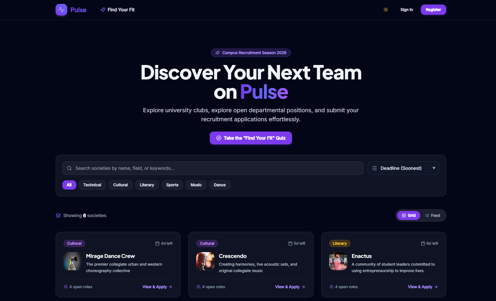

# Pulse — College Society Recruitment Platform

<p align="center">
  
</p>

<p align="center">
  <strong>Streamlined collegiate club recruitments, intelligent discovery, and end-to-end applicant tracking.</strong>
</p>

<p align="center">
  
  
  
  
  
  
  

</p>

---

## Overview

**Pulse** is a modern, unified recruitment management platform designed specifically for collegiate student organizations, tech clubs, cultural societies, and consulting bodies.

Campus recruitments traditionally suffer from scattered Google Forms, lost deadlines, lack of transparency for applicants, and administrative chaos for club committees. Pulse replaces fragmentation with an intuitive glassmorphic portal featuring:

- **Intelligent Discovery & Quiz:** Explore societies categorized by discipline (Technical, Cultural, Literary, Sports, Social Welfare), with instant search, category filtering, and an algorithmic **"Find Your Fit"** personality quiz.
- **Dynamic Application Engine:** Club administrators configure general questions and role-specific requirements. Students submit rich applications, track real-time status updates on a visual timeline, and edit their submissions before hard deadlines.
- **Admin Command Center:** Granular Role-Based Access Control (RBAC) enabling society leads to review submissions, manage recruitment cycles, update application questions, and transition candidates through pipeline stages with constructive feedback.
- **Super Administrator Governance:** Campus-wide observability, society provisioning, leadership delegation, and audit analytics.

---

## Screenshots

 <p align="center">
   
 </p>

---

## Architecture & Design

Pulse follows a decoupled client-server architecture built on RESTful principles:

```
soc-recruitment-app/
├── client/                     # Frontend Single Page Application (SPA)
│   ├── src/
│   │   ├── api/                # Axios instance with auto-injected JWT bearer tokens
│   │   ├── components/         # Reusable UI (Navbar, Glassmorphic Cards, FilterTray, Badges)
│   │   ├── context/            # AuthContext (state & tokens), ThemeContext
│   │   ├── data/               # Quiz configuration and questionnaire rules
│   │   ├── pages/              # Views (Home, Details, Apply, Dashboards, Quiz, Auth)
│   │   └── utils/              # Color palettes, styling helpers, date utilities
│   ├── tailwind.config.js      # Custom theme tokens (Violet/Indigo glassmorphism palette)
│   └── vite.config.js          # Fast HMR Vite bundler configuration
│
├── server/                     # Backend API & Business Logic Layer
│   ├── __tests__/              # Automated test suites (Jest + Supertest)
│   ├── config/                 # Database connection (with in-memory fallback), Cloudinary, Email
│   ├── controllers/            # Controller handlers (Auth, Society, Application, Admin, Notifications)
│   ├── middleware/             # Auth (JWT verification & RBAC), Joi validation, Error handling, Rate limiting
│   ├── models/                 # Mongoose schemas (User, Society, Application, Notification)
│   ├── routes/                 # Express route definitions
│   ├── utils/                  # Mock mailer & notification dispatchers
│   ├── seed.js                 # Database seeder with sample societies and test credentials
│   └── server.js               # Application bootstrap, sanitization, auto-admin provisioning


```

### Key Technical Decisions

1. **Stateless Authentication with RBAC & Multi-Tenant Isolation:** JWT tokens carrying user identity and role tiers (`student`, `society_admin`, `super_admin`) with automated refresh and secure authorization guards. A strict multi-tenant Keychain Guard enforces isolation at the database and API level—guaranteeing that administrators of one society absolutely cannot access, modify, or interfere with the applicant pipelines or settings of any other society.
2. **Resilient Data Layer:** MongoDB with Mongoose schemas featuring compound indexes to prevent duplicate applications. In local development or testing, it includes an automatic fallback to `mongodb-memory-server` if a local MongoDB instance is not detected.
3. **Defense in Depth:** Input payload validation powered by Joi schemas, MongoDB operator injection sanitization via `express-mongo-sanitize`, and IP rate limiting on authentication routes.
4. **Cloud Media & Communication:** Cloudinary asset management for society logos and user profile avatars; Resend transactional email integration with automatic console-logging fallbacks.

---

## Getting Started

Follow these instructions to get a local copy up and running for development and testing.

### Prerequisites

- **Node.js** (v18.0.0 or higher recommended) — [Download Node.js](https://nodejs.org/)
- **npm** (v9.0.0 or higher) or **yarn**
- **MongoDB** (Optional) — A local MongoDB daemon running on `mongodb://127.0.0.1:27017` or a MongoDB Atlas cluster URI. *(If omitted, the server will automatically spin up an embedded in-memory MongoDB instance).*

---

### Step 1: Clone the Repository

```bash
git clone https://github.com/your-username/soc-recruitment-app.git
cd soc-recruitment-app
```

---

### Step 2: Configure Environment Variables

#### Backend Configuration

Copy the sample environment file in the `server` directory:

```bash
cd server
cp .env.example .env
```

Open `server/.env` and update the values:

```env
PORT=5000
NODE_ENV=development
CLIENT_URL=http://localhost:5173
MONGO_URI=mongodb://127.0.0.1:27017/soc_recruitment
JWT_SECRET=super_secret_jwt_key_at_least_32_characters_long_12345

# Optional Third-Party Services:
CLOUDINARY_CLOUD_NAME=
CLOUDINARY_API_KEY=
CLOUDINARY_API_SECRET=
RESEND_API_KEY=

# Optional auto-provisioned super admin:
SUPER_ADMIN_EMAIL=superadmin@college.edu
SUPER_ADMIN_PASSWORD=password123
```

#### Frontend Configuration

Copy the sample environment file in the `client` directory:

```bash
cd ../client
cp .env.example .env
```

Verify that `client/.env` contains:

```env
VITE_API_URL=http://localhost:5000/api
```

---

### Step 3: Install Dependencies

#### Install Server Dependencies

```bash
cd ../server
npm install
```

#### Install Client Dependencies

```bash
cd ../client
npm install
```

---

### Step 4: Seed Initial Data (Societies & Demo Users)

To populate the database with realistic sample collegiate societies (GDG, 180DC, Debating Society, etc.) and ready-to-use demo accounts, run:

```bash
cd ../server
npm run seed
```

---

### Step 5: Start the Development Servers

Open two terminal sessions:

**Terminal 1 — Backend Server:**

```bash
cd server
npm run dev
# Server will start on http://localhost:5000
```

**Terminal 2 — Frontend Application:**

```bash
cd client
npm run dev
# Client will start on http://localhost:5173
```

Navigate to `http://localhost:5173` in your browser.

---

## Demo Credentials

The database seeder generates three role-based test accounts:

| Role | Email | Password | Access Capabilities |
| --- | --- | --- | --- |
| **Super Admin** | `superadmin@college.edu` | `password123` | Global analytics, create/archive societies, promote users to society admins |
| **Society Admin** | `societyadmin@college.edu` | `password123` | Review applicant pipeline for assigned societies, update application questions, toggle recruitment, provide feedback |
| **Student** | `student@college.edu` | `password123` | Explore societies, take quiz, submit/edit applications, track status timeline, receive in-app notifications |

---

## Major API Endpoints

All backend routes are prefixed with `/api`.

### Authentication & Profile (`/api/auth`)

| Method | Endpoint | Access | Description |
| --- | --- | --- | --- |
| `POST` | `/api/auth/register` | Public | Register a new student account |
| `POST` | `/api/auth/login` | Public | Authenticate user & return signed JWT |
| `GET` | `/api/auth/me` | Authenticated | Retrieve current user profile |
| `PUT` | `/api/auth/profile` | Authenticated | Update user information or avatar |
| `POST` | `/api/auth/forgot-password` | Public | Request a password reset token via email |
| `POST` | `/api/auth/reset-password` | Public | Reset account password using token |

### Societies (`/api/societies`)

| Method | Endpoint | Access | Description |
| --- | --- | --- | --- |
| `GET` | `/api/societies` | Public | List active societies with filtering, search & pagination (`?page=&limit=`) |
| `GET` | `/api/societies/:id` | Public | Get detailed society profile, open roles, and application forms |

### Applications (`/api/applications`)

| Method | Endpoint | Access | Description |
| --- | --- | --- | --- |
| `POST` | `/api/applications` | Student | Submit an application for an open role |
| `PATCH` | `/api/applications/:id` | Student (Owner) | Edit application responses prior to deadline |
| `GET` | `/api/applications/my` | Student | Get all applications submitted by current student |

### Society Admin Portal (`/api/admin`)

| Method | Endpoint | Access | Description |
| --- | --- | --- | --- |
| `GET` | `/api/admin/applicants` | Society Admin / Super Admin | Fetch applicant submissions for managed societies |
| `PATCH` | `/api/admin/applicants/:id/status` | Society Admin / Super Admin | Update applicant status (`Under Review`, `Shortlisted`, `Selected`, `Rejected`) and feedback |
| `PUT` | `/api/admin/societies/:id/questions` | Society Admin / Super Admin | Update general and role-specific recruitment questions |
| `PATCH` | `/api/admin/societies/:id/recruitment` | Society Admin / Super Admin | Toggle recruitment open/closed status and deadline |

### Super Admin Governance (`/api/super-admin`)

| Method | Endpoint | Access | Description |
| --- | --- | --- | --- |
| `POST` | `/api/super-admin/societies` | Super Admin | Provision a new campus society |
| `PATCH` | `/api/super-admin/societies/:id/archive` | Super Admin | Archive or unarchive a society |
| `PATCH` | `/api/super-admin/users/:id/promote` | Super Admin | Promote user to society admin & assign club permissions |
| `GET` | `/api/super-admin/users` | Super Admin | List all registered users |
| `GET` | `/api/super-admin/analytics` | Super Admin | Campus-wide recruitment metrics and statistics |

### Notifications & System (`/api/notifications`, `/api/health`)

| Method | Endpoint | Access | Description |
| --- | --- | --- | --- |
| `GET` | `/api/notifications` | Authenticated | List user notifications with unread counts |
| `PATCH` | `/api/notifications/:id/read` | Authenticated | Mark a single notification as read |
| `PATCH` | `/api/notifications/read-all` | Authenticated | Mark all notifications as read |
| `GET` | `/api/health` | Public | Server uptime and health status |

---

## Testing

Pulse backend includes automated test suites covering authentication, applicant business rules, and administrative workflows using **Jest** and **Supertest** against an ephemeral in-memory database:

```bash
cd server
npm test
```

To run individual test suites:

```bash
npm test -- auth.test.js
npm test -- application.test.js
npm test -- admin.test.js
```

---
